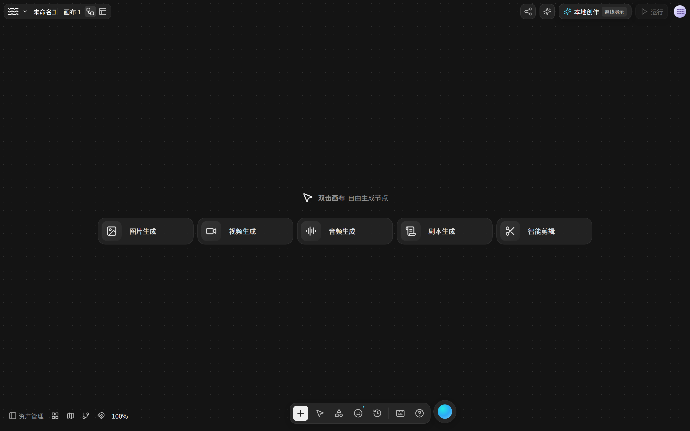
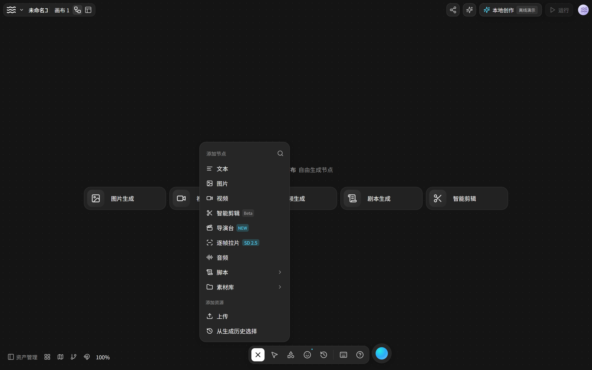
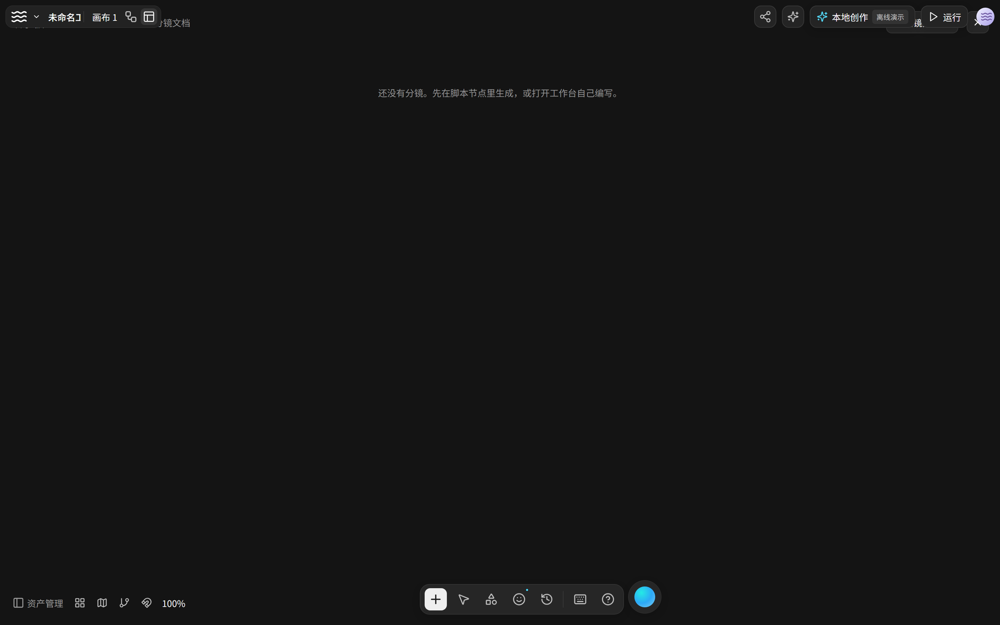
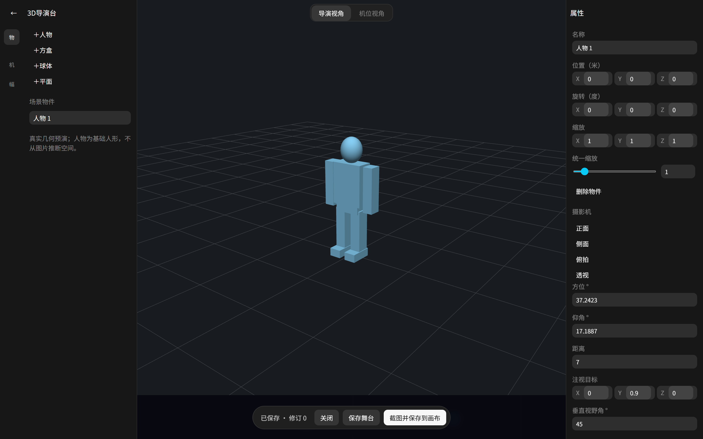
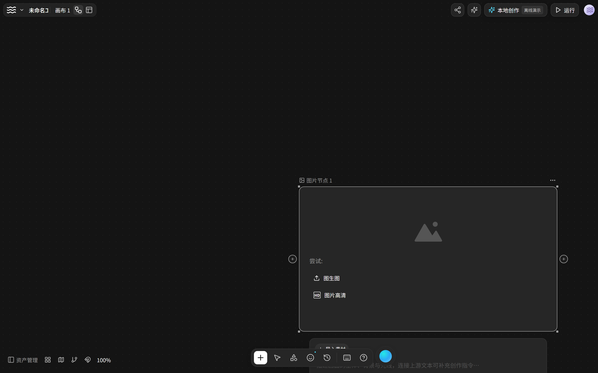

# WhaleFlow · LibTV 风格创作画布

把 LibTV 那套「画布 + 脚本分镜 + 3D 导演台」搬到本地 Windows，模型服务用你自己的。

原站是闭源的在线服务，这里没有它的源码、后端和私有模型——界面与交互是照着可观察的页面用 REA 逐项还原的独立实现。账号、会员、积分、云资产都不涉及。

## 节点式工作流

万物皆节点。文字、图片、视频、音频、脚本、分镜、导演台摆在无限画布上，连线即上下游：

- 右键或按 `Tab` 添加节点，拖拽端口连线，成组、解组、转分镜组
- `Ctrl+Enter` 跑，`Ctrl+S` 存，`Ctrl+Z` 撤销，空格拖动画布
- 一个节点一个任务，结果直接长在画布上，不跳来跳去

## 脚本一键变分镜

脚本节点里有三条路：**剧本生成分镜脚本**、**角色生成分镜脚本**、**自己编写分镜脚本**。

前两条点下去就在节点里跑——骨架屏、进度、随时取消，不弹窗打断你。跑完自动把剧本拆成镜头，**每个镜头生成一个图片节点**摆在画布上，提示词也一并填好。

## 故事板：像连环画看全片

切到故事板，所有镜头按顺序横排成联系表：

- 每格显示画面、标题、时长、景别
- 哪一格不满意，单独点**重抽**，只重跑这一个镜头
- 换过修订的旧图会标出来，不会拿旧图冒充新的

## 3D 导演台

在真正的三维空间里摆机位，而不是靠文字描述画面：

- 拖人形、方盒、球体、平面进去，改位置、旋转、缩放
- 拖旋转视角、滚轮推拉距离，正面/侧面/俯拍/透视一键切
- 摆好之后**截图回画布**，直接当这个镜头的构图参考

截图是真实 WebGL 帧缓冲，不含界面和高亮框。

## 接自己的模型

不绑定任何厂商，界面里自己填：

- 多个服务并存，各自配地址、协议、模型目录
- 文字 / 图片 / 视频 / 语音四种角色分别设默认，单个节点也能单独指定
- 密钥走 Windows 原生密码框，用系统 DPAPI 加密存在本机，网页拿不到明文
- 支持 OpenAI 兼容接口和 Ollama；参考图编辑走 `/images/edits`，视频走 `input_reference`

## 怎么开始

1. 到 [Releases](https://github.com/Breakline3001/whaleflow/releases) 下载 `WhaleFlow-0.4.0-Windows-x64.zip`
2. **整个解压**到可写目录（不能只复制 exe，也不能在压缩包里直接运行）
3. 双击 `WhaleFlow.exe`，右上角进「模型服务设置」填你自己的服务

要求 Windows x64 + .NET Framework 4.8 + 系统自带的 WebView2 Runtime（Win10/11 一般都有）。

没配模型也能玩：空白画布可以载入离线 DEMO，所有交互都能试，只是生成结果是本地占位图，不是 AI 产物。

## 它不做什么

- 不含原站的账号、会员、积分、云资产、协作
- 不接原站私有模型，生成效果取决于你接的服务
- 智能剪辑出片、逐帧拉片引擎、720° 全景：菜单里保留了入口，但没有等价引擎，不会假装成功
- 没有渲染就没有 MP4 导出按钮

## 说明

- 代码 MIT。第三方组件许可见 [THIRD_PARTY_NOTICES.md](THIRD_PARTY_NOTICES.md)
- 项目里的 `research/` 是还原过程留下的观察与量测记录，不是原站源码
- 真实付费模型服务的验收请以你自己的账号为准；仓库里记录的测试用的是本地受控替身
